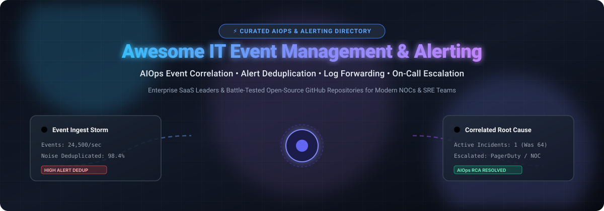

# Awesome IT Event Management & Alerting ⚡

<p align="center">
  
</p>

<p align="center">
  <a href="https://github.com/ishandutta2007/Awesome-Awesome-Awesome"></a>
  <a href="https://discord.gg/jc4xtF58Ve"></a>
  <a href="https://github.com/ishandutta2007/Awesome-IT-Event-Management-Alerting/stargazers"></a>
  <a href="https://github.com/ishandutta2007/Awesome-IT-Event-Management-Alerting/network/members"></a>
  <a href="https://github.com/ishandutta2007/Awesome-IT-Event-Management-Alerting/issues"></a>
  <a href="https://github.com/ishandutta2007/Awesome-IT-Event-Management-Alerting/blob/main/LICENSE"></a>
  <a href="https://github.com/ishandutta2007"></a>
</p>

---

## 📖 Overview & Mission

Welcome to the definitive **Awesome IT Event Management & Alerting** ecosystem guide! 🚀

Modern IT infrastructure, multi-cloud deployments, and distributed microservices generate overwhelming volumes of noisy alerts, metric threshold breaches, syslog streams, and SNMP traps. This repository curates industry-leading **SaaS Platforms** and battle-tested **Open-Source GitHub Projects** engineered to ingest raw telemetry, deduplicate alert storms, perform **AIOps correlation**, identify root-cause incidents, and dispatch automated escalations to on-call SRE and NOC teams.

### 🎯 Key Focus Areas
- 🧠 **AIOps & Algorithmic Correlation**: Machine learning models and heuristics that cluster thousands of alerts into singular, contextual incidents.
- 🔕 **Alert Deduplication & Noise Reduction**: Intelligent threshold grouping, flap damping, and maintenance window suppression.
- 📡 **Telemetry & Log Forwarding**: Enterprise-scale syslog routing, Windows Event Forwarding (WEF), and eBPF/streaming pipelines.
- 🚨 **Incident Lifecycle & On-Call Escalation**: Multi-tier escalation policies, automated paging (SMS/Voice/Push), and bidirectional ITSM/chat integrations.

---

## 📑 Table of Contents
- [📊 Sector Overview & Market Dynamics](#-sector-overview--market-dynamics)
- [☁️ SaaS & Hosted Platforms](#️-saas--hosted-platforms)
- [💻 Open-Source GitHub Projects](#-open-source-github-projects)
- [🛠️ Architectural Recipes for Custom Stacks](#️-architectural-recipes-for-custom-stacks)
- [🤝 How to Contribute](#-how-to-contribute)
- [💖 Support & Sponsorship](#-support--sponsorship)
- [⭐ Star History](#-star-history)
- [📜 Disclaimer](#-disclaimer)

---

## 📊 Sector Overview & Market Dynamics

The global **AIOps and IT Event Management / Alerting** market is valued at approximately **$14 billion to $21 billion**, expanding rapidly at an estimated compound annual growth rate (CAGR) of **18% to 24%** and projected to exceed $60 billion by the 2030s.

The sector exhibits a **consolidated upper-tier oligopoly** at the enterprise level, where platform giants (ServiceNow, Datadog, Cisco/Splunk, and Atlassian) absorb point solutions into unified suites covering APM, log aggregation, and full ITSM workflows. Concurrently, the lower-to-mid tier remains **moderately fragmented** around the open-source and developer-tooling edge, driven by specialized demand for Kubernetes-native event processors, eBPF telemetry, and agentic AI remediation engines.

---

## ☁️ SaaS & Hosted Platforms

Below is a detailed comparison of market-leading SaaS solutions for enterprise IT event management, alert correlation, and automated incident escalation. Entries are sorted in **descending order by company size** (market capitalization or acquisition/enterprise valuation).

| SaaS Platform 🏢 | Valuation / Market Cap 💰 | Specific Starting Price 🏷️ | Specific Free Tier / Free Trial Limits 🎁 | Core Event Management & Alerting Highlights ⚡ |
| :--- | :--- | :--- | :--- | :--- |
| **[Dell Moogsoft](https://moogsoft.com)** (Dell Technologies) | ~$210B Market Cap (Parent Dell; Moogsoft acq. 2023) | Custom enterprise quote; historic standalone starting at ~$8.33/user/month | No permanent free tier; 14-day fully featured proof-of-concept free trial with synthetic event injection | Algorithmic AIOps event correlation, unsupervised noise reduction, anomaly detection, and automated alert clustering across hybrid clouds. |
| **[ServiceNow ITOM Event Management](https://servicenow.com)** | ~$105B Market Cap | Custom enterprise quote; discovery & visibility starts at ~$0.50–$1.50/node/month (~$80–$120/node/year) | Indefinite free Personal Developer Instance (PDI) with full administrative platform access (hibernates if idle; reclaimed after 14 days inactivity) | Enterprise ITOM suite consolidating events, machine-learning noise filtering, automated CMDB service mapping, and automated ITSM incident generation. |
| **[Datadog Event Management](https://datadoghq.com)** | ~$62B Market Cap | Standalone On-Call seat at $20/seat/month (annual) or $24/seat/month (monthly); Incident Response Bundle at $40/seat/month (annual) | 14-day full-feature trial; permanent free tier covers basic infrastructure monitoring up to 5 hosts with 1-day metric retention (excludes paid Event Management/On-Call seats) | Cloud observability event correlation engine aggregating alerts from Datadog monitors and third-party webhooks into deduplicated incident streams. |
| **[Opsgenie](https://atlassian.com)** (Atlassian) | ~$38B Market Cap | Essentials tier starts at $9.45/user/month (annual) or $11/user/month (monthly); Standard tier at $19.95/user/month | Permanent Free Tier for up to 5 users, includes unlimited push/email alerts, basic on-call schedules, 1 escalation policy, and capped at 100 SMS notifications account-wide (no voice calls) | Alert aggregation, deduplication rules, flexible on-call scheduling, and direct escalation synchronization with Jira Service Management. |
| **[Splunk On-Call](https://splunk.com)** (formerly VictorOps; Cisco) | ~$28B Acquisition Valuation (Acquired by Cisco) | Starter tier starts at $5.00/user/month (annual commitment, teams up to 10 users); Enterprise plans custom quoted | 14-day free trial supporting up to 10 user seats with unrestricted access to on-call scheduling, live incident routing, and mobile triage | High-speed incident routing, trans-incident collaboration, mobile alerting, and telemetry runbook enrichment alongside triggered events. |
| **[Dynatrace Events & Davis AI](https://dynatrace.com)** | ~$12.8B Market Cap | Infrastructure Monitoring at $0.04/host-hour (~$29/host/month); Full-Stack APM at $0.01/memory-GiB-hour (~$58/month for an 8 GiB host) | 15-day free trial with full platform access and live telemetry ingestion; interactive permanent public sandbox playground | Causal Davis® AI event correlation, deterministic dependency mapping (Smartscape), automatic root-cause pinpointing, and alert suppression. |
| **[SolarWinds Hybrid Cloud & Event Forwarder](https://solarwinds.com)** | ~$4.4B Enterprise Value (Taken private by Turn/River) | Event Log Forwarder is 100% Free freeware; SolarWinds Observability starts at $8.00/node/month (billed annually) | 30-day fully functional free trial for enterprise monitoring suites (unrestricted features, evaluation node cap); Event Log Forwarder freeware has unlimited time & hosts | Windows event log forwarding utility converting Windows Security, System, and App logs into syslog/SNMP traps, backed by enterprise hybrid monitoring. |
| **[Freshworks Event Management (Freshservice)](https://freshworks.com)** | ~$3.4B Market Cap | Pro Plan starts at $99/agent/month (billed annually) or $119/agent/month (monthly) to unlock ITOM Alert & Event Management | 14-day free trial with unrestricted access to Pro/Enterprise ITOM alert management features (no credit card required; no permanent free tier) | ITSM-integrated alert management capturing events from monitoring tools, automated alert deduplication, and workflow-driven ticket resolution. |
| **[BigPanda](https://bigpanda.io)** | ~$1.2B Private Valuation | Custom enterprise tier; software catalog benchmarks estimate baseline entry at ~$6,000/user/year | No self-serve permanent free tier; guided 14-day proof-of-concept (PoC) evaluation available upon sales qualification | Open AIOps event correlation platform ingesting massive multi-source alert streams, grouping related alerts into unified incidents, and driving automated runbooks. |
| **[PagerDuty](https://pagerduty.com)** | ~$1.25B Market Cap | Professional tier starts at $21/user/month (billed annually) or $25/user/month (monthly); Business tier at $41/user/month | Permanent Free Tier for up to 5 users, limited to 1 on-call schedule, 1 escalation policy, and 100 SMS/phone notifications per month | Digital operations management, real-time alert routing, machine learning alert grouping, intelligent noise suppression, and automated escalation workflows. |

---

## 💻 Open-Source GitHub Projects

Explore the top open-source projects for self-hosted event management, alert deduplication, notification multiplexing, and observability pipelines. Repositories are sorted in **descending order by GitHub star count**.

| Project & Repository 📦 | GitHub Stars ⭐ | Primary Focus / Category 🏷️ | Architecture & Alerting Capabilities ⚙️ |
| :--- | :--- | :--- | :--- |
| **[Uptime Kuma](https://github.com/louislam/uptime-kuma)** | [](https://github.com/louislam/uptime-kuma/stargazers) | Synthetic Event & Availability Monitoring | Self-hosted monitoring tool for HTTP(s), TCP, DNS, and gRPC endpoints with customizable notification dispatch and status pages. |
| **[Netdata](https://github.com/netdata/netdata)** | [](https://github.com/netdata/netdata/stargazers) | Real-Time Metrics & Anomaly Alerting | Distributed real-time health and anomaly detection engine with per-second metrics, pre-configured alert rules, and zero configuration. |
| **[SigNoz](https://github.com/signoz/signoz)** | [](https://github.com/signoz/signoz/stargazers) | OpenTelemetry Observability & Alerting | Full-stack APM built on ClickHouse; supports metric/log/trace alerting, query builders, and integrations with PagerDuty and Slack. |
| **[Jaeger](https://github.com/jaegertracing/jaeger)** | [](https://github.com/jaegertracing/jaeger/stargazers) | Distributed Tracing & Latency Events | CNCF distributed tracing platform used to isolate latency bottlenecks, transaction failures, and root causes across microservices. |
| **[Vector](https://github.com/vectordotdev/vector)** | [](https://github.com/vectordotdev/vector/stargazers) | Observability Data Pipeline & Log Forwarder | Ultra-fast Rust pipeline for transforming, deduplicating, parsing, and routing high-volume logs, metrics, and security events. |
| **[Wazuh](https://github.com/wazuh/wazuh)** | [](https://github.com/wazuh/wazuh/stargazers) | Security Event Monitoring & Active Response | Enterprise SIEM and XDR platform providing agent-based event log aggregation, vulnerability correlation, and active response alerting. |
| **[Apprise](https://github.com/caronc/apprise)** | [](https://github.com/caronc/apprise/stargazers) | Universal Push Notification Gateway | Python notification library and microservice routing IT alerts to 90+ endpoints (Slack, Teams, Telegram, Discord, SMS, Email, Webhooks). |
| **[Gatus](https://github.com/TwiN/gatus)** | [](https://github.com/TwiN/gatus/stargazers) | Automated Health Check & Incident Alerting | Developer-centric automated service health monitoring tool with built-in alert triggers and crisp status dashboards. |
| **[Keep](https://github.com/keephq/keep)** | [](https://github.com/keephq/keep/stargazers) | Open-Source AIOps & Alert Management | The leading open-source AIOps platform; aggregates alerts from 50+ tools, deduplicates events, and triggers automated remediation playbooks. |
| **[Prometheus Alertmanager](https://github.com/prometheus/alertmanager)** | [](https://github.com/prometheus/alertmanager/stargazers) | Core Alert Routing & Deduplication Engine | Industry-standard alerting hub for Prometheus; handles deduplication, alert grouping, silencing, inhibition, and routing. |
| **[Fluent Bit](https://github.com/fluent/fluent-bit)** | [](https://github.com/fluent/fluent-bit/stargazers) | Cloud-Native Log & Event Processor | Lightweight C-based processor for collecting, filtering, enriching, and forwarding logs and events across Kubernetes and edge systems. |
| **[Graylog Community](https://github.com/Graylog2/graylog2-server)** | [](https://github.com/Graylog2/graylog2-server/stargazers) | Centralized Log Management & Alerting | Fast, scalable log ingestion server supporting GELF, syslog, and Elasticsearch indexing with customizable event alert conditions. |
| **[OpenTelemetry Collector](https://github.com/open-telemetry/opentelemetry-collector)** | [](https://github.com/open-telemetry/opentelemetry-collector/stargazers) | Vendor-Agnostic Telemetry Pipeline | Ingests, processes, transforms, and exports telemetry (logs, events, traces, metrics) using vendor-neutral OpenTelemetry standards. |
| **[Zabbix](https://github.com/zabbix/zabbix)** | [](https://github.com/zabbix/zabbix/stargazers) | Enterprise IT Monitoring & Event Correlation | Mature monitoring platform offering complex trigger logic, parent-child dependency suppression, event correlation, and auto-remediation. |
| **[Prometheus Blackbox Exporter](https://github.com/prometheus/blackbox_exporter)** | [](https://github.com/prometheus/blackbox_exporter/stargazers) | Blackbox Probing & Endpoint Alerting | Probes endpoints over HTTP, HTTPS, DNS, TCP, and ICMP to generate availability metrics and alert events inside Prometheus. |
| **[LibreNMS](https://github.com/librenms/librenms)** | [](https://github.com/librenms/librenms/stargazers) | Network Monitoring & SNMP Event Manager | Auto-discovering network monitoring suite featuring SNMP trap handling, syslog ingestion, and flexible multi-channel alert transports. |
| **[Riemann](https://github.com/riemann/riemann)** | [](https://github.com/riemann/riemann/stargazers) | Complex Event Stream Processing (CEP) | High-throughput, low-latency Clojure stream processor designed for aggregating, calculating moving windows, and alerting on events. |
| **[Grafana OnCall](https://github.com/grafana/oncall)** | [](https://github.com/grafana/oncall/stargazers) | On-Call Scheduling & Escalation Management | Developer-friendly incident response system with deep Slack/Telegram integrations, calendar scheduling, and escalation routing. |
| **[Bosun](https://github.com/bosun-monitor/bosun)** | [](https://github.com/bosun-monitor/bosun/stargazers) | Time-Series Alerting Framework | Robust alerting engine developed by Stack Overflow with an expressive domain-specific language for analyzing time-series datasets. |
| **[GoAlert](https://github.com/target/goalert)** | [](https://github.com/target/goalert/stargazers) | On-Call Scheduling & Notification Escalation | Open-source enterprise alert routing and schedule management platform developed by Target for high-availability operational response. |
| **[Shell-Operator](https://github.com/flant/shell-operator)** | [](https://github.com/flant/shell-operator/stargazers) | Kubernetes Event-Driven Scripting | Tool for running bash/python scripts in response to Kubernetes cluster events, enabling self-healing loops and automated event handling. |
| **[Alerta](https://github.com/alerta/alerta)** | [](https://github.com/alerta/alerta/stargazers) | Centralized Alert Console & De-duplicator | Monitoring console that normalizes and deduplicates alerts across Prometheus, Nagios, AWS CloudWatch, Zabbix, and syslog feeds. |
| **[syslog-ng](https://github.com/syslog-ng/syslog-ng)** | [](https://github.com/syslog-ng/syslog-ng/stargazers) | High-Performance Syslog Forwarder | Enhanced logging daemon providing structured message parsing, pattern matching, message classification, and high-volume routing. |
| **[rsyslog](https://github.com/rsyslog/rsyslog)** | [](https://github.com/rsyslog/rsyslog/stargazers) | High-Speed Log Processing Daemon | Rocket-fast Unix logging utility capable of handling over one million messages per second with disk-assisted memory queues. |
| **[Icinga 2](https://github.com/Icinga/icinga2)** | [](https://github.com/Icinga/icinga2/stargazers) | Distributed Infrastructure Monitoring | Scalable multi-zone monitoring engine featuring dependency trees, alert flapping logic, and flexible notification templates. |
| **[Prometheus SNMP Exporter](https://github.com/prometheus/snmp_exporter)** | [](https://github.com/prometheus/snmp_exporter/stargazers) | SNMP Telemetry & Hardware Traps | Translates SNMP metrics and trap events from enterprise network gear, switches, and PDUs into structured Prometheus metrics. |
| **[Nagios Core](https://github.com/nagiosenterprises/nagioscore)** | [](https://github.com/nagiosenterprises/nagioscore/stargazers) | Host & Service Event Monitor | Foundational IT monitoring engine utilizing parent-child host dependency suppression and event handler auto-remediation scripts. |
| **[ElastAlert 2](https://github.com/jertel/elastalert2)** | [](https://github.com/jertel/elastalert2/stargazers) | Elasticsearch & OpenSearch Alerting | Rule-based anomaly detection framework querying Elasticsearch/OpenSearch clusters to trigger alerts on spike patterns and errors. |
| **[Sensu Go](https://github.com/sensu/sensu-go)** | [](https://github.com/sensu/sensu-go/stargazers) | Observability Pipeline & Event Handler | Multi-cloud monitoring pipeline that collects check results, filters out transient noise, and routes event payloads to incident handlers. |

---

## 🛠️ Architectural Recipes for Custom Stacks

Building a production-ready, self-hosted, noise-reduced IT event management and alerting architecture:

```
[ Infrastructure & Cloud Telemetry ]
   │
   ├── Windows Event Logs / Syslog ──► [ Vector / Fluent Bit / syslog-ng ]
   │                                                    │
   ├── SNMP Traps / Network Feeds   ──► [ SNMPTT / SNMP Exporter ]
   │                                                    │
   └── Metrics & Health Probes     ──► [ Prometheus / Netdata / Uptime Kuma ]
                                                        │
                                                        ▼
                                     [ Keep AIOps / Alertmanager / Alerta ]
                                            (Deduplication & Correlation)
                                                        │
                                                        ▼
                                          [ GoAlert / Grafana OnCall ]
                                            (On-Call Escalation Matrix)
                                                        │
                                                        ▼
                                         [ Apprise Notification Bus ]
                                      (Slack / Teams / SMS / Telegram / Pager)
```

- **Low-Latency Ingestion & Forwarding**: Use **Vector** or **Fluent Bit** for log/event filtering and transformation before routing to storage.
- **Noise Reduction & Root Cause Correlation**: Pair **Keep** or **Prometheus Alertmanager** to correlate hundreds of concurrent metric thresholds down into a single actionable incident.
- **On-Call Scheduling & Paging**: Deploy **GoAlert** or **Grafana OnCall** for automated escalation policies, combined with **Apprise** for multi-channel notification dispatch.

---

## 🤝 How to Contribute

We welcome additions, updates, and corrections from the community! 🌟

1. **Fork** the repository: [ishandutta2007/Awesome-IT-Event-Management-Alerting](https://github.com/ishandutta2007/Awesome-IT-Event-Management-Alerting).
2. **Create a branch**: `git checkout -b feature/add-new-tool`.
3. **Add your tool**: Ensure SaaS entries include verified starting prices and explicit free trial/tier limits; ensure open-source entries link to the repository and include their star count badge.
4. **Submit a Pull Request** with a brief summary of the proposed changes.

---

## 💖 Support & Sponsorship

If you find this curated ecosystem directory helpful in designing, evaluating, or optimizing your IT event management and alerting pipelines, please consider showing your support:

- ⭐ **Star this repository** to help others discover it!
- 🍴 **Fork and share** with your DevOps, SRE, and NOC engineering colleagues.
- ☕ **Buy a coffee & sponsor**: If this project saved you hours of research, you can support ongoing maintenance via the [GitHub Sponsor Dashboard](https://github.com/sponsors/ishandutta2007).

---

## ⭐ Star History

[](https://www.star-history.com/#ishandutta2007/Awesome-IT-Event-Management-Alerting&type=date&legend=top-left)

---

## 📜 Disclaimer

Product names, logos, brands, and registered trademarks referenced in this repository belong to their respective copyright holders. All price quotes, limits, and metrics are documented for informational and architectural comparison purposes as of November 2026. Please consult vendor documentation directly for real-time contractual quotes.
